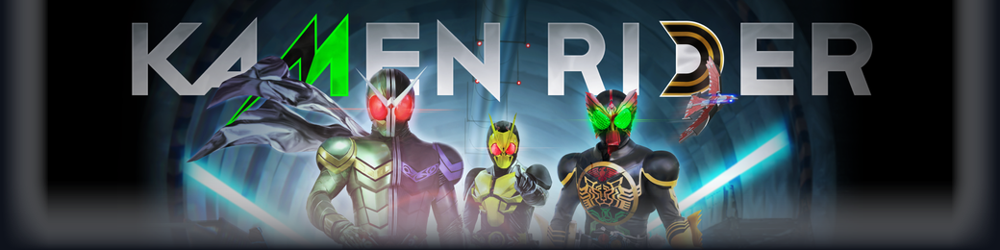

# Kamen Rider: Memory of Heroes — PC Native Edition

<p align="center">
  
</p>

<p align="center">
  
  
  
  
  
  
</p>

---

## Overview

**Kamen Rider: Memory of Heroes — PC Native Edition** is a standalone, high-performance launcher and native runtime suite designed to bring the PlayStation 4 Tokusatsu action title (*CUSA17374*) to PC with true PC-native feel, ultra-low input latency, silky-smooth 60 FPS gameplay, and complete modern PC control support.

Built specifically around the heroic trio:
- **Kamen Rider Double (W)** — Cyclone & Joker
- **Kamen Rider OOO** — Tatoba (Taka, Tora, Batta)
- **Kamen Rider Zero-One** — Rising Hopper

---

## Credits & Development Team

- **Port Lead & Creator:** **AO Zero**
- **Community Partner & Subbing Group:** [**Bakka Sub**](https://www.bakkasub.my.id) (https://www.bakkasub.my.id)

---

## Key Features

### Zero-Touch Mouse & Keyboard Aim Sync
- **No Manual Hotkeys:** Mouse look engages **100% automatically** upon booting into the game. No need to press `F7` or fumble with toggle hotkeys.
- **Micro-Aim Precision:** Fine-tuned internal analog stick translation allows 1-pixel micro movements for fluid camera control.
- **Customizable Sensitivity:** In-launcher mouse sensitivity slider with immediate live updates.

### Dual-Device Full Keybinding Remapper
- **Full Customization:** Remap any button for **Keyboard & Mouse** or **Gamepad (Xbox / PlayStation / DualSense / Generic)**.
- **Interactive Button Picker:** Visual controller remapping modal with instant two-way synchronization.
- **Dedicated Gamepad Deadzone:** Dynamic left/right analog deadzone adjustment from 1% to 30%.

### 60 FPS Native Performance Unlocker
- **Zero Stutter Engine:** High-performance direct memory pool (`2048 MB DMEM / 1024 MB FMEM`) eliminates streaming hitches.
- **Windows 1ms Multimedia Timer:** Automated `timeBeginPeriod(1)` thread scheduler to eradicate frame pacing micro-stutter.
- **Fast Shader Math & Pipeline Archiving:** Shaders compile on background worker threads with direct Vulkan pipeline caching.

### Next-Gen Upscaling (AMD FSR 3.1 & NVIDIA DLSS)
- Choose from **Native Resolution**, **AMD FSR 3.1**, **AMD FSR 1.0 (Potato PC Mode)**, or **NVIDIA DLSS**.
- 1-Click Optimization Presets:
  - **Potato PC / Max FPS:** 720p + AMD FSR Performance (50%) + 60 FPS
  - **Balanced Experience:** 1080p + AMD FSR 3.1 Quality (67%) + 60 FPS
  - **Ultra Fidelity:** 1080p / 1440p / 4K Native + 60 FPS

### Full Bilingual Support (Indonesian & English)
- **Instant Reactive Language Switcher:** Switch between **Bahasa Indonesia (ID)** and **English (EN)** with a single click on the header button (`ID / EN`) or inside the Tools tab.
- All UI text, tab names, settings descriptions, and trophy logs update seamlessly in real time.

### Custom Savegame Manager
- **Slot Discovery:** Automatically scans and identifies all active save slots (`KmrSave`, `KmrSaveGame0`, `KmrSaveGame6`, etc.).
- **1-Click Timestamped Backups:** Backup all your saves into compressed zip archives inside `saves_backup/`.
- **Instant Restore:** Easily restore previous backup archives with automatic safety copies.
- **100% Complete Savegame Preset:** Unlock all Riders, forms, and maximum skills with a single click.

### Achievement & Trophy Tracker
- **Authentic PS4 Trophy Catalog:** 50 trophies categorized into Platinum, Gold, Silver, and Bronze.
- **Rarity Badges & Stats:** Tracks completion percentage and total points with filter toggles (*All, Unlocked, Locked*).
- **Localized Descriptions:** Fully translated trophy criteria in both Indonesian and English.

### AO Zero Watermark
- Integrated branding watermark embedded into the header and launcher interface to ensure genuine distribution.

### Built-in 1-Click Update PKG Installer
- Automatically scans your workspace or prompts you to select PS4 Update PKG files (such as `Update v1.01`).
- Extracts and applies game updates into your game folder without command-line tools.

---

## System Requirements

| Component | Minimum (720p 60 FPS) | Recommended (1080p / 1440p 60 FPS) |
| :--- | :--- | :--- |
| **Operating System** | Windows 10 (x64) build 1909+ | Windows 11 (x64) 22H2+ |
| **Processor (CPU)** | Intel Core i5-8400 / AMD Ryzen 5 2600 | Intel Core i5-12400 / AMD Ryzen 5 5600X |
| **Memory (RAM)** | 8 GB DDR4 | 16 GB Dual-Channel DDR4/DDR5 |
| **Graphics (GPU)** | NVIDIA GTX 1060 (6GB) / AMD RX 580 (8GB) | NVIDIA RTX 2060 / 3060 / AMD RX 6600 |
| **Vulkan Support** | Vulkan 1.3 Compatible Driver | Vulkan 1.3.260+ Latest Driver |
| **Storage** | 15 GB Free Space (SSD strongly recommended) | NVMe M.2 SSD |

---

## Installation & Setup Guide

> **No Game Assets Included**: This repository and release packages contain **ONLY** the launcher and optimization runtime tools. You must provide your own legally dumped copy of the game.

### Step 1: Download the Launcher
- Download the pre-compiled zip package from the [Releases](https://github.com/ao-zero/kamen-rider-memory-of-heroes-pc/releases) tab.
- *OR* Clone this repository to build from source:
  ```bash
  git clone https://github.com/ao-zero/kamen-rider-memory-of-heroes-pc.git
  ```

### Step 2: Add Your Game Dump
Place your extracted PS4 base game dump (*CUSA17374*) into the `CUSA17374` folder:
```text
Kamen-Rider-Memory-of-Heroes-PC-Edition/
├── Kamen Rider Memory of Heroes.exe
├── launcher.ini
├── README.txt
├── bin/
├── assets/
└── CUSA17374/
    ├── README_DUMP.txt
    ├── eboot.bin      <--- (Make sure eboot.bin is here!)
    ├── sce_sys/
    └── ...
```
*Note: If your game dump is located on another drive or folder, you can simply click the **Browse** button in the launcher to select your game folder.*

### Step 3: Run and Play
1. Launch **`Kamen Rider Memory of Heroes.exe`**.
2. Configure your graphics preset, resolution, and keybinds.
3. Click **PLAY GAME**.

---

## Default Controls

### Keyboard & Mouse (Auto-Sync)

> **Catatan Penting (Known Issue):**  
> Konfigurasi kustom untuk Mouse dan Keyboard saat ini masih terdapat beberapa bug teknis dan sedang dalam tahap perbaikan intensif (*work in progress*). Untuk pengalaman bermain terbaik dan paling stabil, disarankan menggunakan stik controller / gamepad atau gunakan konfigurasi default bawaan.  
> *(English: Custom Keyboard & Mouse configuration currently has known bugs and is actively undergoing fixes. Using a controller is recommended for the best experience).*

| Action | Keyboard / Mouse Input |
| :--- | :--- |
| **Move (Character)** | `W`, `A`, `S`, `D` |
| **Camera (Look Around)** | `Mouse Movement (Zero-Touch Auto Look)` |
| **Light Attack / Square** | `Left Mouse Button` |
| **Heavy Attack / Triangle** | `Right Mouse Button` |
| **Jump / Confirm / Cross** | `Spacebar` |
| **Dodge / Cancel / Circle** | `Left Shift` |
| **R1 (Rider Power / Stance)** | `E` |
| **L1 (Guard / Lock-On)** | `Q` |
| **R2 (Special Skill)** | `Middle Mouse Button` |
| **L2 (Form Change)** | `F` |
| **Options / Pause** | `Escape` |
| **Touchpad / Map** | `Tab` |

### Gamepad (Xbox / PlayStation)
| Action | Xbox Gamepad | PlayStation DualShock / DualSense |
| :--- | :--- | :--- |
| **Move** | Left Analog Stick | Left Analog Stick |
| **Camera** | Right Analog Stick | Right Analog Stick |
| **Square** | `X` Button | `Square` |
| **Triangle** | `Y` Button | `Triangle` |
| **Cross** | `A` Button | `Cross` |
| **Circle** | `B` Button | `Circle` |
| **Lock-On / Guard** | `LB` | `L1` |
| **Form Change** | `LT` | `L2` |
| **Rider Power** | `RB` | `R1` |
| **Special Skill** | `RT` | `R2` |
| **Pause** | `Menu / Start` | `Options` |

---

## Building from Source

To build the standalone executable:

1. **Clone the repository:**
   ```bash
   git clone https://github.com/ao-zero/kamen-rider-memory-of-heroes-pc.git
   cd kamen-rider-memory-of-heroes-pc
   ```
2. **Install Python dependencies:**
   ```bash
   python -m pip install -r requirements.txt
   ```
3. **Run 1-Click Builder:**
   Double click `build.bat` or run:
   ```bash
   python -m PyInstaller "Kamen Rider Memory of Heroes.spec" --noconfirm
   ```

---

## Acknowledgments & Technical References

- **[shadPS4 Emulator](https://github.com/shadps4-emu/shadPS4)**  
  *Official Site:* [shadps4.net](https://shadps4.net/) &bull; *GitHub:* [shadps4-emu/shadPS4](https://github.com/shadps4-emu/shadPS4)  
  *Attribution:* Open-source PlayStation 4 emulator delivering direct Vulkan 1.3 translation, x86-64 native execution, pipeline caching, and custom trophy architecture (`custom_trophy/` and `trophy_notification_side: "right"`).

- **[AzaharPlus / shadPS4Plus](https://github.com/AzaharPlus/shadPS4Plus)**  
  *Repository:* [AzaharPlus/shadPS4Plus](https://github.com/AzaharPlus/shadPS4Plus)  
  *Attribution:* Enhanced shadPS4 emulator fork and open-source PlayStation 4 PKG extractor engine (`ShadPs4Plus-PkgExtractor-1.1-windows`).

- **CTR-NitroFueled-PC / SacredFire Project**  
  *Key Developers:* T3CHTR1CK, [deadinside28](https://github.com/deadinside28), [Supermedo](https://github.com/Supermedo), bbport  
  *Attribution:* Essential design reference for standalone PC native launcher ergonomics, `launcher.ini` configuration, top-right trophy notification popup integration, and portable packaging best practices.

- **Illusion0001**  
  *Attribution:* PlayStation 4 frame-timing reverse-engineering, 60 FPS unlocking patches, and engine timing research.

- **TroyWarez**  
  *Attribution:* Research and community tooling for PS4 package extraction and update patch management.

- **AO Zero**  
  *Attribution:* Port Lead & Developer for *Kamen Rider: Memory of Heroes PC Native Edition*. Developed Zero-Touch Mouse Look auto-sync, 60 FPS Vulkan 1.3 profile, bilingual UI architecture, and custom savegame & trophy manager.

- **[Bakka Sub](https://www.bakkasub.my.id)**  
  *Community Partner:* [www.bakkasub.my.id](https://www.bakkasub.my.id)  
  *Attribution:* Indonesian Tokusatsu fansub provider, Indonesian subtitle localization, Tokusatsu preservation, and community partner.

- 

---

## Legal Disclaimer

- *Kamen Rider: Memory of Heroes* is a trademark and copyright of **BANDAI NAMCO Entertainment Inc.**, **ISHIMORI PRODUCTION INC.**, and **TOEI COMPANY, LTD.**
- This project is a non-commercial, fan-made launcher utility designed for interoperability and preservation purposes.
- **NO copyrighted binaries, assets, game files, audio, video, or ROMs are distributed within this repository.**
- Users must own a legitimate copy of the game and dump their own files from their personal PlayStation 4 console.
